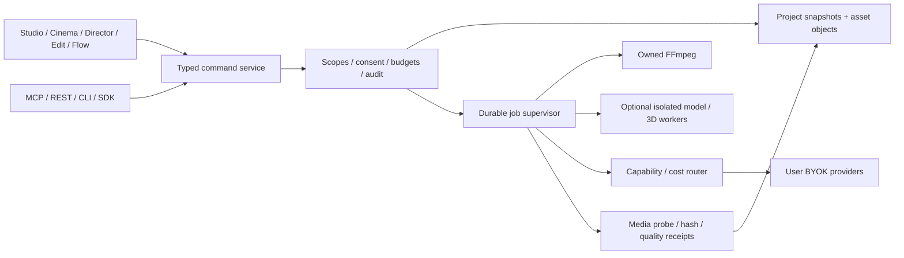

# Architecture recommendation

**Proposed D: small Yamakan core with qualified adapted modules.** Independent Claude review and founder approval are pending. See [competition](ARCHITECTURE_OPTIONS.md) and [ADR 0002](adr/0002-yamakan-modular-foundation.md).

Retain React/TypeScript views and Node local command host for the first offline slice. Use owned FFmpeg subprocesses, optional isolated Python/ComfyUI/Blender/native workers and BYOK adapters. No Python/GPU requirement for launching Edit. One project/timeline format owns edit state; UI, agents and donor modules translate through typed commands.

Continue immutable verified JSON snapshots/content objects for MVP, with one writer lock and crash reconciliation. A single transactional SQLite journal/index can replace a boundary if measured workload requires it; never add Pluma's store as competing canonical truth. Morize/vector indexes remain rebuildable project views. Prepared jobs bind immutable project/asset revisions, policy and provider receipt; ambiguous external outcomes cannot auto-resubmit.

Desktop: qualify a thin Tauri host using ArtCraft/Ninerr patterns, with hardened Electron fallback only if packaging/IPC tests justify it. Neither is a qualified Yamakan release today. Web distribution requires a separate authenticated multi-user service/storage/worker boundary; loopback authentication is not internet-ready.

Costs remain real: advanced preview/export parity, camera application, schema migration, secure packaging, inference scheduling and adapter churn. Reverse this recommendation if a challenger passes the documented parity experiment or Node/JSON workload measurements fail accepted budgets. Saved workflows remain declarative approved node types; no project JSX/eval in trusted service.
