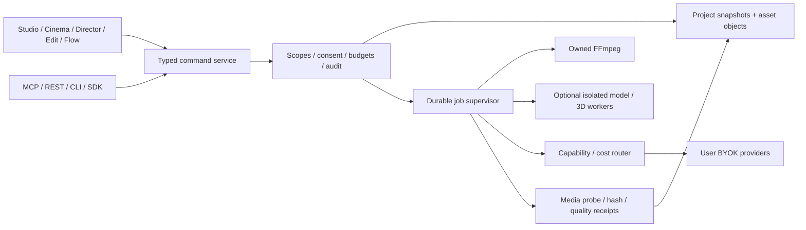

# Architecture recommendation

**Proposed D′ (D as amended by the [independent Claude review](review/CLAUDE_INDEPENDENT_REVIEW.md)): small Yamakan core with qualified adapted modules.** Independent review is recorded; founder approval is pending ([decision packet](FOUNDER_DECISION_PACKET.md)). See [competition](ARCHITECTURE_OPTIONS.md) and [ADR 0002](adr/0002-yamakan-modular-foundation.md).

Retain React/TypeScript views and Node local command host for the first offline slice. Use owned FFmpeg subprocesses, optional isolated Python/ComfyUI/Blender/native workers and BYOK adapters. No Python/GPU requirement for launching Edit. One project/timeline format owns edit state; UI, agents and donor modules translate through typed commands.

**Persistence (amended).** One SQLite operational index per workspace (`node:sqlite`, WAL, `synchronous=FULL`) owns heads, the revision index, idempotency, jobs, attempts, budget reservations and leases. Immutable canonical-JSON snapshots and media remain content-addressed blobs. A commit fsyncs the blob, then performs a compare-and-swap on `expectedRevision` in one transaction; only a committed row means success. This replaces rename-published `head.json`, which lost acknowledged edits with a second writer (review T2b) and failed under Windows share locks (T1). Never add Pluma's store or a donor store as competing truth. Morize/vector indexes remain rebuildable views. Prepared jobs bind immutable project/asset revisions, policy and provider receipt; ambiguous external outcomes cannot auto-resubmit.

**Render and text (amended).** A render-plan IR compiled from a frozen revision drives FFmpeg export and the preview. Titles and subtitles are ASS events rendered by libass in both paths (FFmpeg `subtitles` filter; JASSUB in preview) with bundled fonts, because FFmpeg `drawtext` lays out RTL with a left-to-right base direction (review T4).

**Desktop (amended).** The MVP ships as local web on loopback (already E2E-proven). A parallel spike chooses Tauri 2 or hardened Electron (decision D). The Tauri capability file is written deny-by-default; **ArtCraft's `tauri.conf.json`/capabilities and its `browser_emulation`/consumer-cookie client crates are excluded** (review B2). On Windows the desktop host owns a no-breakaway Job Object containing the service and all workers, because Node-spawned grandchildren survive a crash (review T3). Neither shell is a qualified Yamakan release today. Web distribution to other machines requires a separate authenticated multi-user boundary; loopback authentication is not internet-ready.

Costs remain real: advanced preview/export parity, camera application, schema migration, secure packaging, inference scheduling and adapter churn. Reverse this recommendation if a challenger passes the documented parity experiment or Node/JSON workload measurements fail accepted budgets. Saved workflows remain declarative approved node types; no project JSX/eval in trusted service.
