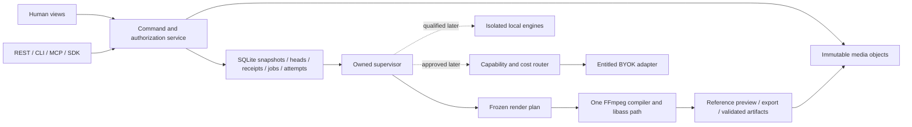

# Final proposed architecture

**Retain Claude's D′ and tighten its operational contracts.** One canonical core, SQLite, content-addressed media, unified timeline, typed commands, owned FFmpeg/libass, bounded source reuse, isolated optional engines and local web before desktop. Approval pending. [Plan](IMPLEMENTATION_PLAN.md), [contracts](OPERATIONAL_CONTRACTS.md), [assessment](review/FINAL_OPTIMIZATION_REVIEW.md) and proposed [ADR 0002](adr/0002-yamakan-modular-foundation.md) agree.

Canonical metadata snapshot bytes live **inside** the transaction acknowledging a revision; immutable JSON exports preserve their hashes. Claude's fsync-file-then-DB proposal leaves Windows directory-entry durability outside SQLite. No power-cut evidence justifies an unconditional cross-store guarantee. The bounded new DB spike supports a narrower kill/replay contract, not production/power-loss safety. External media publication remains independently qualified.

Jobs/attempts use lease fencing, validation-before-success and cancel-before-publication predicates; reject the journal draft. Render plans specify time, mapping, layers, fit, alpha, SDR conversion, audio and typography. FFmpeg reference preview uses export semantics; Canvas/proxy/JASSUB fast paths earn parity claims separately.

| Choice | Benefit / migration cost | Decision |
|---|---|---|
| Refined D′ | Existing prototype/schemas retained; incremental DB/plan/command adapters | Preferred; no competing application/state engine |
| External snapshot CAS | Small DB heads, but file publication and DB refs require coordinated recovery | External media retained; small snapshots inside SQLite simplify acknowledged-edit integrity |
| Whole OpenCut Classic | Mature editing; global singleton, browser storage, WASM/Bun renderer and transport migration | No measured migration win; pure algorithms only; bounded 53 pass/4 fail +23 separate passes is not full qualification |
| ArtCraft/filmmaker shell | Existing creative UI; unsafe credential/permission/IPC and separate state | Keep qualified creative modules; fresh minimal shell after ADR |
| MLT/Kdenlive/Blender renderer | Mature native media/3D; native builds and alternate effect semantics | Optional worker/interchange challenger; no measured superiority here |
| FFmpeg reference preview | Avoids second canonical effect semantics; cache/latency/decoding cost | Preferred truth path; T8 blocks on usability; fast subset tested |

Migration costs above are inspected dependency comparisons, not benchmarks. An extra snapshot DB table/transaction is bounded; whole editor replacements must translate persistence/reducer/timeline/render/auth/API contracts. No challenger passed identical clean-host UI/MCP acceptance, so none earns a switch. Reopen only with that experiment and a bounded migration estimate.

Tauri 2 is provisionally preferred for later desktop; hardened Electron can win on measured codec/IPC/lifecycle/install evidence. Use fresh deny-by-default capabilities, no inherited broad ArtCraft scope or renderer-controlled shell. Native supervision covers service death and host death. Networks/weights stay disabled until exact-operation qualification. Local-account scope is not internet tenancy.
